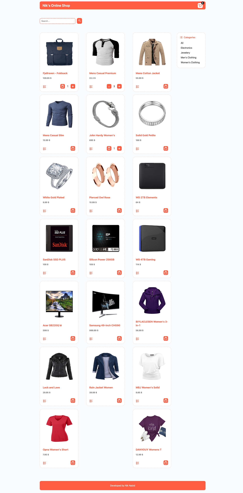
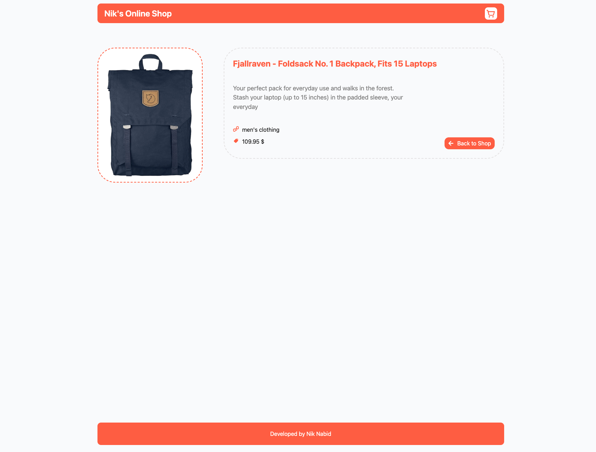
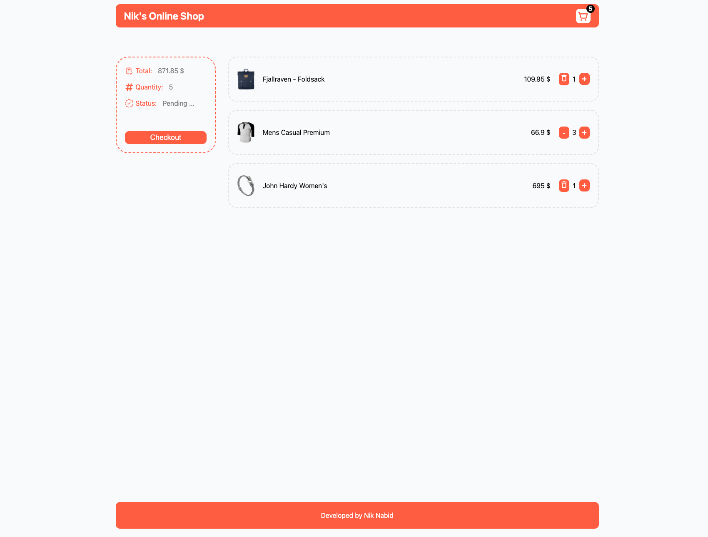
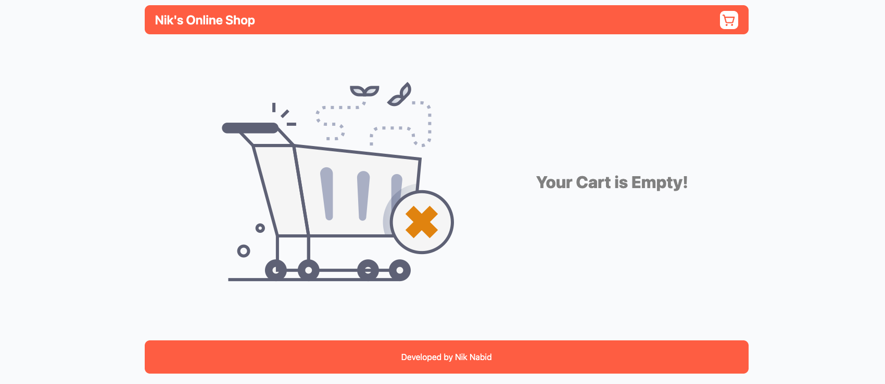

<div align="center">

# 🛍️ Nik's Online Shop

### A React e-commerce storefront with product search, category filters, URL-synchronized browsing, and a persistent shopping cart.

Built with **React 19**, **Vite**, **React Router**, **Context API**, **useReducer**, **Axios**, and **CSS Modules**.

[Explore the Source Code](https://github.com/MojtabaNabid/onlineShop)

</div>

---

## 📖 Overview

**Nik's Online Shop** is a frontend e-commerce project developed to practice building a multi-page shopping experience with React. The application fetches products from the [Fake Store API](https://fakestoreapi.com/), allows users to find products by name and category, displays individual product details, and provides an interactive shopping cart.

The project focuses on several important frontend concepts: **reusable components**, **shared state management**, **reducer-based cart logic**, **client-side routing**, **URL query parameters**, **API integration**, and **browser storage**.

> **Project scope:** This is a frontend/demo shop. The checkout action clears the shopping cart; it does **not** process payments, create orders on a backend, or authenticate users.

## ✨ Features

### 🛒 Product catalog
- Fetches the product catalog from the **Fake Store API** using an Axios instance.
- Displays product images, shortened titles, and prices in reusable product cards.
- Provides a dedicated product details page with the full title, description, category, image, and price.
- Shows a loading spinner while the product list or requested product details are not yet available.

### 🔎 Search and category filtering
- Searches product titles using **case-insensitive substring matching**.
- Executes a search when the user clicks the **Search** button.
- Filters products by **All**, **Electronics**, **Jewelery**, **Men's Clothing**, and **Women's Clothing**.
- Applies the search term and category filter **together**, so users can narrow results using both options.
- Handles search and filtering locally on the products already fetched from the API.

### 🔗 URL query parameters
- Synchronizes the active product search and category filter with the URL using React Router's `useSearchParams`.
- Supports URLs such as:

  ```text
  /products?search=shirt
  /products?category=electronics
  /products?search=shirt&category=men%27s+clothing
  ```

- Reads URL query parameters when the product list initializes, so a refreshed or shared product-list URL can restore its search/filter selection.
- Removes the `search` parameter when the search input is cleared and removes `category` when **All** is selected, keeping URLs cleaner.
- Uses a dynamic route, `/products/:id`, for individual product pages.

### 🛍️ Shopping cart
- Add products to the cart directly from catalog cards.
- Increase or decrease product quantities.
- Remove a product when its quantity is `1` using the delete button.
- Display the total number of units in the cart badge and cart summary.
- Calculate the total cost from each item's **price × quantity**.
- View selected products and their quantities on the checkout page.
- Show a dedicated empty-cart message when no products are selected.
- Use the **Checkout** button to reset the cart and update the checkout state locally.

### 💾 Persistent cart with localStorage
- Restores previously saved cart state when the cart reducer is initialized.
- Saves changes in cart state to the browser's `localStorage` under the key `state`.
- Keeps selected products and quantities when the page is refreshed or reopened in the same browser storage context.
- Stores JSON using `JSON.stringify()` and restores it using `JSON.parse()`.

### 🎨 User interface
- Organizes the application into reusable cards, navigation, sidebars, pages, and loading components.
- Uses **CSS Modules** for component-scoped styling and a global stylesheet for shared styles.
- Uses **React Icons** for the cart, search, category list, product details, prices, and quantity controls.
- Uses **React Loader Spinner** (`RotatingLines`) to indicate loading states.
- Includes a shared header and footer and a basic 404 route.

---

## 📸 Screenshots


### Product listing


### Product details


### Shopping cart


### Empty shopping cart


---

## 🧰 Tech Stack

| Technology | Role in the project |
| --- | --- |
| **React 19** | Component-based UI and state management |
| **JavaScript (ES modules / JSX)** | Application logic and components |
| **Vite 8** | Development server and production build tooling |
| **React Router DOM 6** | Client-side routing, route parameters, and search parameters |
| **Context API** | Shared product and cart state across components |
| **useReducer** | Centralized cart actions and state transitions |
| **Axios** | Fetching product data from the REST API |
| **Fake Store API** | External demo product data source |
| **localStorage** | Browser-side cart persistence |
| **CSS Modules** | Component-scoped styles |
| **React Icons** | UI icons |
| **React Loader Spinner** | Loading indicator |
| **ESLint** | Code linting |

## 🪝 React Hooks Used

| Hook | Where it is used | Purpose |
| --- | --- | --- |
| `useState` | `ProductsContext.jsx`, `ProductsPage.jsx` | Store fetched products, displayed products, search input, and query state |
| `useEffect` | `ProductsContext.jsx`, `ProductsPage.jsx`, `CartContext.jsx` | Fetch products, synchronize search/filter state, and persist cart changes |
| `useContext` | Custom hooks in `ProductsContext.jsx` and `CartContext.jsx` | Read shared data without passing props through every component |
| `useReducer` | `CartContext.jsx` | Manage cart actions and derived totals |
| `useSearchParams` | `ProductsPage.jsx` | Read and update query parameters in the browser URL |
| `useParams` | `DetailsPage.jsx` | Read the product ID from `/products/:id` |

### Custom hooks

- **`useProducts()`** — returns the list of products from `ProductContext`.
- **`useProductDetail(id)`** — finds a product in the shared product list using its numeric ID.
- **`useCart()`** — returns `[state, dispatch]` from `CartContext`.

> `useProductDetail()` looks up products already fetched into context; it does not make a separate API request for the individual product.

---

## 🧠 State Management and Application Architecture

### Product context

`ProductsProvider` loads products from `/products` in a `useEffect` and shares the resulting array with the application through `ProductContext`.

```jsx
const [products, setProducts] = useState([]);

useEffect(() => {
  const fetchProducts = async () => {
    try {
      setProducts(await api.get("/products"));
    } catch (error) {
      console.log(error.message);
    }
  };

  fetchProducts();
}, []);
```

Components use `useProducts()` for the catalog and `useProductDetail(id)` for the details page. This avoids making a new product-list request in each card or page.

### Cart context and reducer

`CartProvider` shares a **cart state** and its `dispatch` function. Cart updates are expressed as actions, making the shopping behavior easier to organize across different components.

```js
const initialState = {
  selectedItems: [],
  itemsCounter: 0,
  total: 0,
  checkout: false,
};
```

| Action | Behavior |
| --- | --- |
| `ADD_ITEM` | Adds a product with `quantity: 1` if it is not already in the cart |
| `REMOVE_ITEM` | Removes the selected product from the cart |
| `INCREASE` | Increments a selected product's quantity |
| `DECREASE` | Decrements a selected product's quantity |
| `CHECKOUT` | Clears the cart, resets totals, and marks checkout as `true` |

The `sumProducts()` helper uses JavaScript's **`reduce()`** method to compute:

- **`itemsCounter`** — sum of all selected item quantities (not just unique products).
- **`total`** — sum of `product.price * product.quantity` across all cart items, formatted to two decimal places.

The `productQuantity(state, id)` helper checks whether a product is in the cart and returns its current quantity (or `0` when absent). This is used to switch between an **Add to Cart** button and quantity controls on each product card.

### Cart persistence

The cart reducer uses a lazy initializer to restore saved state before the app begins handling cart actions:

```jsx
const init = (initialState) => {
  const savedState = localStorage.getItem("state");
  return savedState ? JSON.parse(savedState) : initialState;
};

const [state, dispatch] = useReducer(reducer, initialState, init);

useEffect(() => {
  localStorage.setItem("state", JSON.stringify(state));
}, [state]);
```

**Flow:** Load saved JSON → initialize cart state → dispatch cart actions → update state → save the new state.

---

## 🔍 How Search, Filters, and the URL Work Together

The product listing maintains separate state values for the text input (`search`), the selected query (`query`), and the resulting products (`displayed`).

1. **Enter text:** `SearchBox` normalizes typed text to lowercase and trims whitespace.
2. **Submit search:** Clicking the search button updates the query object using `createQueryObject()`.
3. **Choose a category:** The sidebar updates the same query object and preserves the other active filter.
4. **Update the URL:** `setSearchParam(query)` writes the active search and category to the address bar.
5. **Filter the catalog:** `searchedProduct()` filters product titles, followed by `filterProducts()` for exact category matches.
6. **Display results:** The component updates `displayed` with the matching products.

The following helpers live in `src/helpers/helper.js`:

| Helper | Responsibility |
| --- | --- |
| `searchedProduct(products, search)` | Finds product titles containing the search term |
| `filterProducts(products, filter)` | Selects products whose category matches the selected category |
| `createQueryObject(currentQuery, newQuery)` | Merges changes and removes empty search / `all` category parameters |
| `getInitialQuery(searchParam)` | Reconstructs a query object from URL search parameters |
| `shortenText(text)` | Displays only the first three words of titles in cards |
| `sumProducts(products)` | Calculates cart unit count and total price |
| `productQuantity(state, id)` | Gets a product's current cart quantity |

**Example user journey:**

```text
Open /products
    ↓
Search for "shirt"
    ↓
URL: /products?search=shirt
    ↓
Select "Men's Clothing"
    ↓
URL includes both search and category
    ↓
Only products matching both conditions remain
    ↓
Select "All" to remove the category restriction
```

> **Implementation detail:** Search/filter results are derived from the client-side product array. The app does not send separate server-side search requests.

---

## 🧭 Routing

Navigation is handled with React Router's `BrowserRouter`, `Routes`, `Route`, `Navigate`, and `Link`.

| Route | Screen / behavior |
| --- | --- |
| `/` | Redirects to `/products` |
| `/products` | Product catalog with search and category filtering |
| `/products?search=...` | Catalog with a search query |
| `/products?category=...` | Catalog filtered by category |
| `/products/:id` | Product details using the URL product ID |
| `/checkout` | Cart summary and checkout/reset action |
| Any unmatched route | Basic 404 page |

`useParams()` reads the ID in `DetailsPage`, and the ID is converted to a number before searching the shared product array.

---

## 🌐 API Integration

Product data comes from the public [Fake Store API](https://fakestoreapi.com/).

**Base URL**

```text
https://fakestoreapi.com
```

**Endpoint used**

```http
GET /products
```

Axios is configured once in `src/services/config.js`:

```js
import axios from "axios";

const api = axios.create({ baseURL: "https://fakestoreapi.com" });

api.interceptors.response.use(
  (response) => response.data,
  (error) => Promise.reject(error),
);

export default api;
```

The response interceptor returns `response.data` directly, so components can work with the product array without repeatedly accessing `.data`.

**Product properties used:** `id`, `title`, `price`, `description`, `category`, and `image`.

---

## 🗂️ Project Structure

```text
onlineShop/
├── public/
│   ├── emptyShoppingBasket.png
│   ├── favicon.svg
│   └── icons.svg
├── src/
│   ├── components/
│   │   ├── BasketCard.jsx
│   │   ├── BasketSidebar.jsx
│   │   ├── Card.jsx
│   │   ├── Loader.jsx
│   │   ├── SearchBox.jsx
│   │   ├── Sidebar.jsx
│   │   └── *.module.css
│   ├── constants/
│   │   └── list.js
│   ├── context/
│   │   ├── CartContext.jsx
│   │   └── ProductsContext.jsx
│   ├── helpers/
│   │   └── helper.js
│   ├── layout/
│   │   ├── Layout.jsx
│   │   └── Layout.module.css
│   ├── pages/
│   │   ├── 404.jsx
│   │   ├── CheckoutPage.jsx
│   │   ├── DetailsPage.jsx
│   │   ├── ProductsPage.jsx
│   │   └── *.module.css
│   ├── services/
│   │   └── config.js
│   ├── App.jsx
│   ├── global.css
│   └── main.jsx
├── index.html
├── package.json
├── package-lock.json
├── eslint.config.js
└── vite.config.js
```

### Main UI components

- **`Layout`** — shared header, shopping-cart badge, page content, and footer.
- **`Card`** — product preview, details link, and add/remove/quantity controls.
- **`SearchBox`** — controlled search field and search submission button.
- **`Sidebar`** — selectable product categories.
- **`BasketCard`** — selected cart item with line price and quantity controls.
- **`BasketSidebar`** — order total, total item quantity, status, and checkout button.
- **`Loader`** — animated loading indicator.

---

## 🚀 Getting Started

### Prerequisites

- A compatible version of **Node.js** and **npm** (see the [Vite documentation](https://vite.dev/guide/) for current Node.js requirements).
- Internet access to retrieve products from Fake Store API.

### 1. Clone the repository

```bash
git clone https://github.com/MojtabaNabid/onlineShop.git
cd onlineShop
```

### 2. Install dependencies

```bash
npm install
```

### 3. Start the development server

```bash
npm run dev
```

Open the local URL printed by Vite (typically `http://localhost:5173`).

### Other scripts

```bash
npm run build    # Build for production
npm run preview  # Preview the production build locally
npm run lint     # Run ESLint
```

No API key or `.env` configuration is required by the current source code.

---

## 📚 What This Project Demonstrates

- Building reusable UI components with React and JSX.
- Fetching asynchronous data with `useEffect` and Axios.
- Sharing product information using Context API and custom hooks.
- Handling complex cart updates with `useReducer` and dispatched actions.
- Using `reduce()`, `filter()`, and `find()` to process product data.
- Keeping filtering state in sync with query parameters.
- Implementing dynamic product-detail routes.
- Persisting browser state with `localStorage`.
- Organizing application logic into contexts, components, pages, helpers, and services.

---

## 👨‍💻 Author

**Nik Nabid**

GitHub: [@MojtabaNabid](https://github.com/MojtabaNabid)

---

<div align="center">

**Thanks for checking out Nik's Online Shop! ⭐**

</div>
